<div align="center">

# 🎓 Acme School · Plataforma de exámenes en línea

**Aplicación web institucional para presentar, administrar y calificar exámenes**
HTML5 · CSS3 · JavaScript (ES6+) · Web Components nativos · `localStorage`

[Repositorio en GitHub](https://github.com/castrorueda-afk/acme-exams-platform-Juan-Castro)

</div>

---

## 📑 Tabla de contenido

1. [Descripción general](#1-descripción-general)
2. [Estructura visual (mockups)](#2-estructura-visual-mockups)
3. [Flujo de uso](#3-flujo-de-uso)
4. [Estructura del proyecto y arquitectura](#4-estructura-del-proyecto-y-arquitectura)
5. [Ramas y flujo de trabajo en Git](#5-ramas-y-flujo-de-trabajo-en-git) (incluye el [registro de cambios](#55-registro-de-cambios-posteriores-a-la-fase-visual))
6. [Requerimientos → dónde se implementan](#6-requerimientos--dónde-se-implementan)
7. [Explicación detallada del código](#7-explicación-detallada-del-código)
8. [Modelo de datos](#8-modelo-de-datos)
9. [Reglas de validación](#9-reglas-de-validación)
10. [Cómo ejecutarlo y probarlo](#10-cómo-ejecutarlo-y-probarlo)
11. [Limitaciones y mejoras futuras](#11-limitaciones-y-mejoras-futuras)
12. [Autoría](#12-autoría)

---

## 1. Descripción general

**Acme School** es una plataforma de exámenes en línea con dos perfiles:

| Perfil | Acceso | Qué puede hacer |
|--------|--------|-----------------|
| 🎒 **Estudiante** | Público, sin contraseña | Ver el catálogo, identificarse, resolver un examen con cuenta regresiva y ver su resultado (APROBÓ / NO APROBÓ). |
| 👩‍🏫 **Docente / Administrativo** | Privado, con correo y contraseña | Gestionar usuarios, exámenes y preguntas, y consultar los resultados de todos los estudiantes. |

**Características principales**

- 5 exámenes de ejemplo precargados (Cultura General, Biología, Matemáticas, Lengua Castellana y Física), cada uno con 5 preguntas de 4 opciones y una sola respuesta correcta.
- Temporizador regresivo `MM:SS` que cambia de color en el último minuto y envía el examen automáticamente al llegar a `00:00`.
- Registro del **tiempo exacto** que tardó cada estudiante, junto con curso, correo, fecha y estado.
- Validación en tiempo real en **todos** los formularios (borde verde/rojo, mensaje claro y foco automático al primer error).
- Hero institucional con carrusel automático de imágenes (cada 3 segundos).
- Diseño responsive y accesible, sin frameworks ni dependencias.
- Persistencia en `localStorage`: los datos y la **sesión del docente** sobreviven a recargas y al cierre del navegador.

> 📌 **Últimos cambios:** carrusel del hero, registro del estudiante con 4 campos obligatorios, validación en tiempo real, sesión persistente y corrección del reinicio de datos. Consulta el [registro de cambios (sección 5.5)](#55-registro-de-cambios-posteriores-a-la-fase-visual).

> **Tecnologías:** HTML5 semántico · CSS3 (variables, grid, flexbox, `:has()`) · JavaScript vanilla modular · Web Components (`customElements.define`, Shadow DOM) · `localStorage`.

---

## 2. Estructura visual (mockups)

> Los siguientes gráficos son **wireframes de estructura** (no son capturas de pantalla). Cada etiqueta naranja indica el Web Component o la función del código que dibuja esa zona. Los archivos fuente editables están en [`docs/mockups`](docs/mockups) en formato SVG y PNG.

### 2.1 Escritorio (monitor, 1440 px)

#### 🏠 Bienvenida y selección de perfil

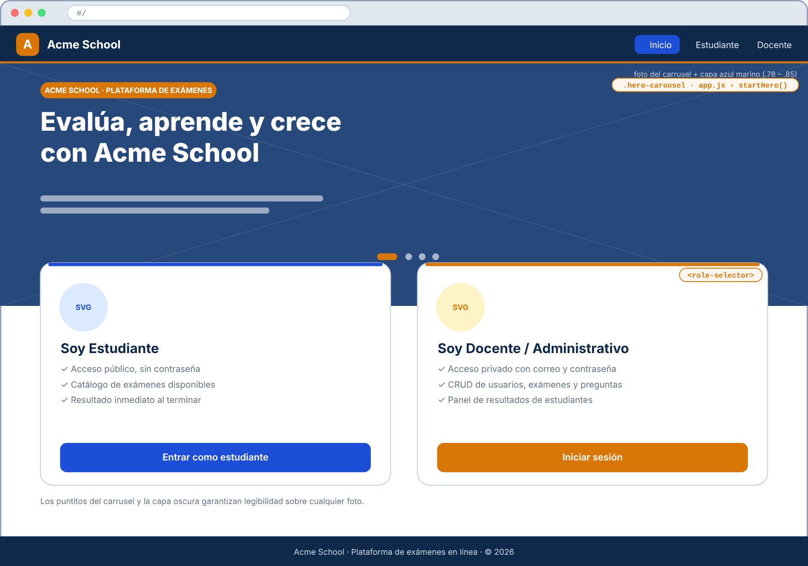

*Hero con carrusel (`app.js › welcome / startHero`) y las dos tarjetas de perfil (`<role-selector>`).*

#### 📚 Catálogo de exámenes

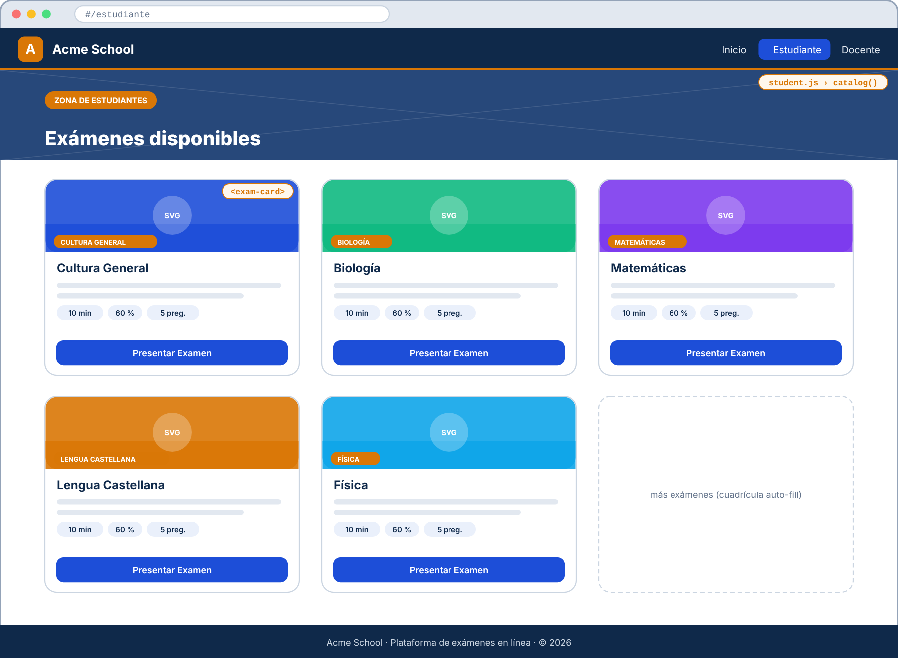

*Cuadrícula de tarjetas `<exam-card>` generadas por `student.js › catalog()`.*

#### 🪪 Identificación del estudiante (modal con validación)

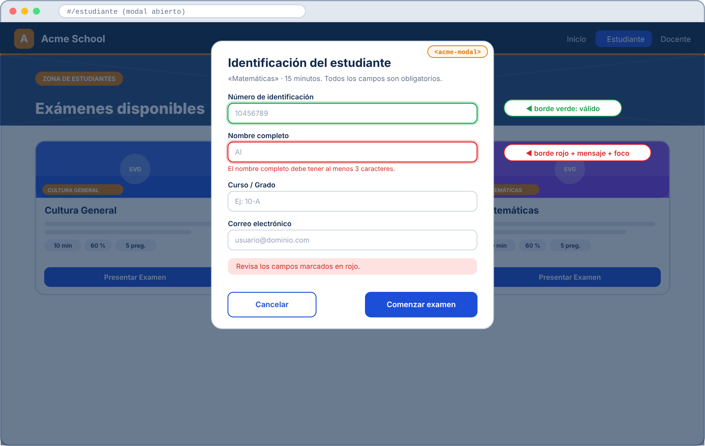

*`<acme-modal>` con los 4 campos obligatorios; borde verde cuando es válido, rojo con mensaje cuando no.*

#### ⏱️ Examen en curso

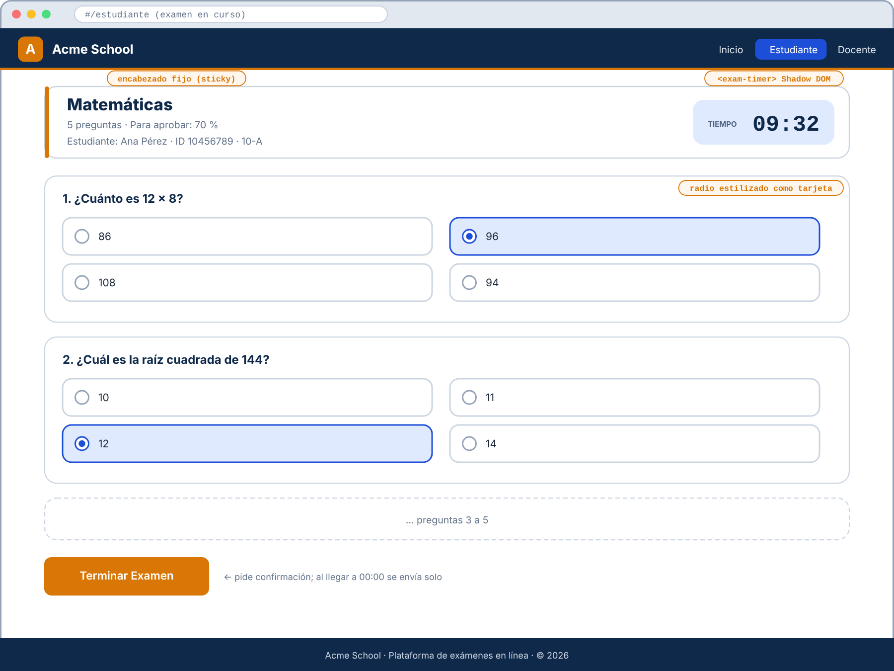

*Encabezado `sticky` con `<exam-timer>` (Shadow DOM) y opciones tipo tarjeta.*

#### ✅ Resultado

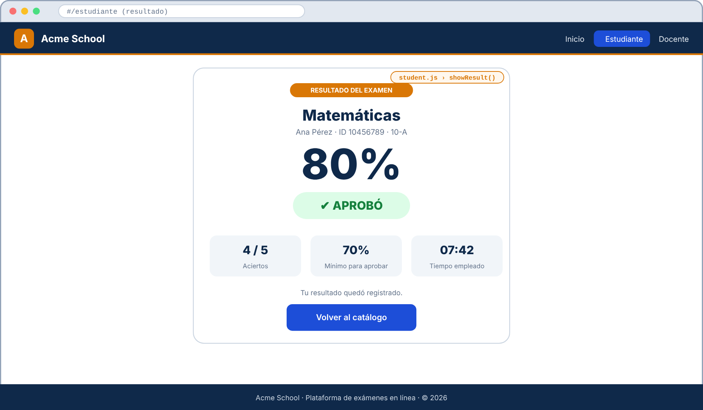

*`student.js › showResult()`: porcentaje, estado, aciertos y tiempo empleado.*

#### 🔐 Login de docentes y administrativos

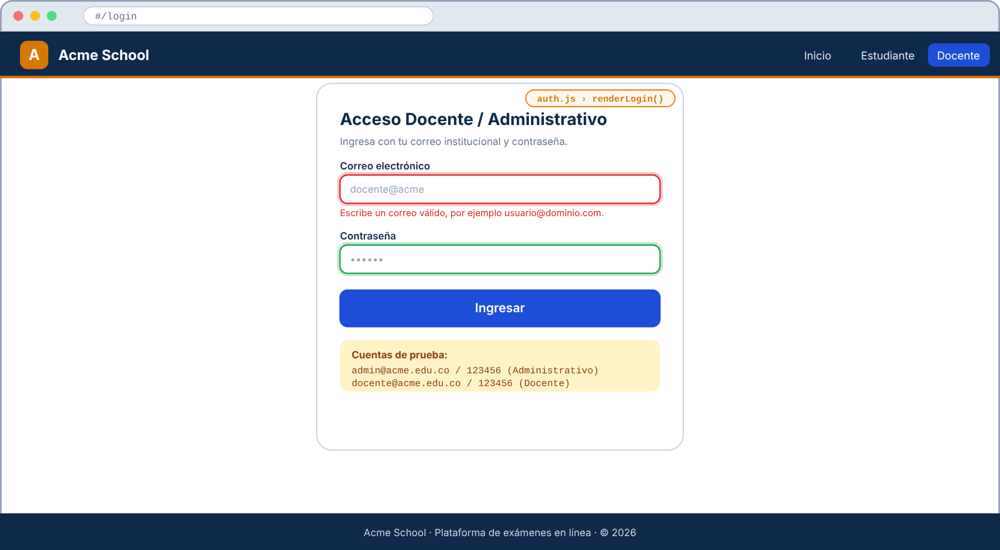

*`auth.js › renderLogin()` con aviso discreto de cuentas de prueba.*

#### 👥 Gestión de usuarios

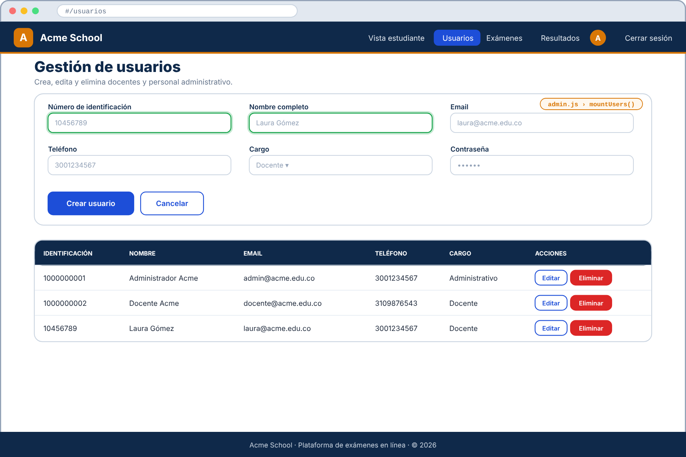

*`admin.js › mountUsers()`: formulario + tabla con Editar / Eliminar.*

#### 📝 Gestión de exámenes y preguntas

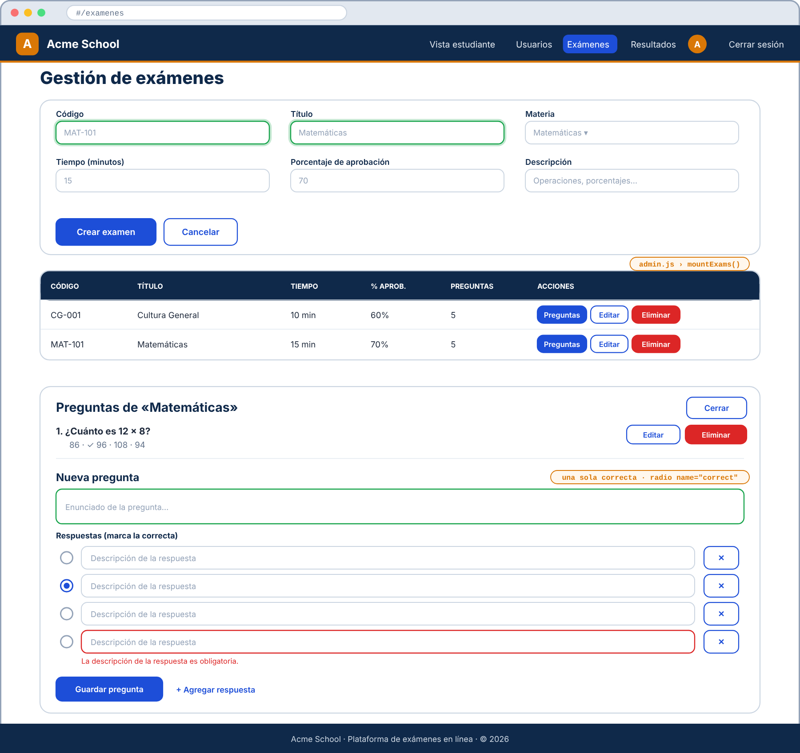

*`admin.js › mountExams()`: CRUD de exámenes y gestor de preguntas con una sola respuesta correcta.*

#### 📊 Resultados de estudiantes (vista del docente)

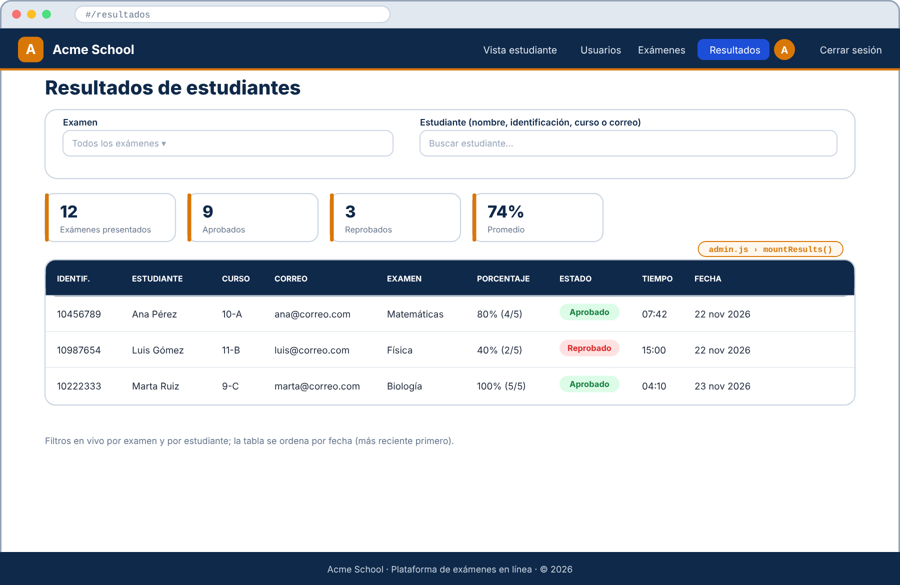

*`admin.js › mountResults()`: filtros en vivo, contadores y tabla de 9 columnas.*

### 2.2 Celular (móvil, 375 px)

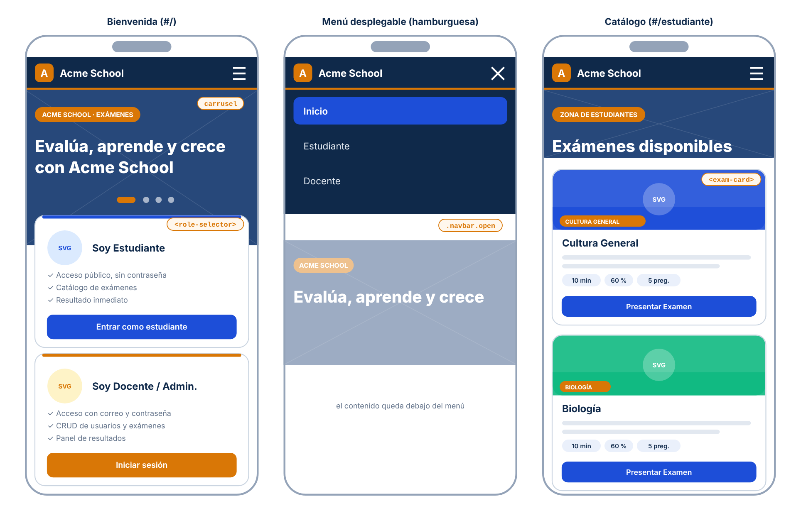

*Bienvenida, menú hamburguesa (`.navbar.open`) y catálogo en una sola columna.*

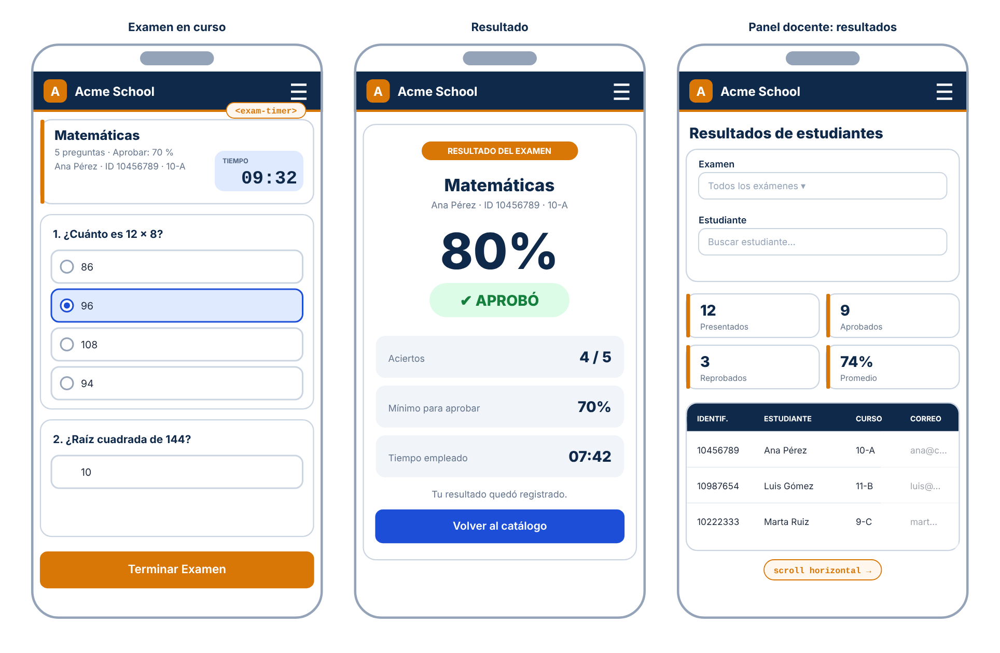

*Examen, resultado y panel docente (la tabla se desplaza horizontalmente dentro de `.table-wrap`).*

---

## 3. Flujo de uso

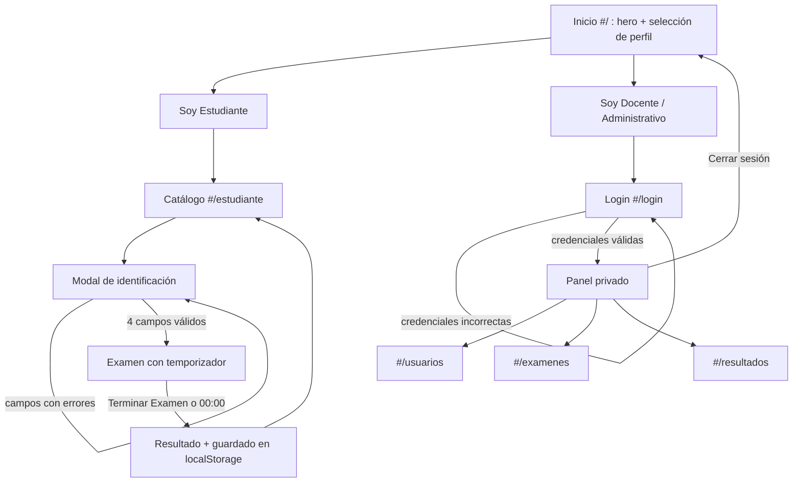

**Credenciales de prueba** (se cargan solas la primera vez):

| Cargo | Correo | Contraseña |
|-------|--------|------------|
| Administrativo | `admin@acme.edu.co` | `123456` |
| Docente | `docente@acme.edu.co` | `123456` |

**Rutas** (router por hash, definido en `js/app.js`):

| Ruta | Acceso | Vista | Módulo que la monta |
|------|--------|-------|---------------------|
| `#/` | Público | Bienvenida y perfiles | `app.js › welcome()` |
| `#/estudiante` | Público | Catálogo y resolución | `student.js › mount()` |
| `#/login` | Público | Inicio de sesión | `auth.js › renderLogin()` |
| `#/usuarios` | 🔒 Privado | CRUD de usuarios | `admin.js › mountUsers()` |
| `#/examenes` | 🔒 Privado | CRUD de exámenes y preguntas | `admin.js › mountExams()` |
| `#/resultados` | 🔒 Privado | Resultados de estudiantes | `admin.js › mountResults()` |

---

## 4. Estructura del proyecto y arquitectura

```
acme-exams-platform/
├── index.html
├── README.md
├── css/
│   └── styles.css
├── docs/
│   ├── architecture.png / .svg
│   ├── git-flow.png / .svg
│   ├── git-graph.png
│   └── mockups/
│       ├── d01-bienvenida … d09-resultados   (.png / .svg)
│       └── m01-publico-1, m02-publico-docente-2   (.png / .svg)
└── js/
    ├── storage.js
    ├── validation.js
    ├── components.js
    ├── auth.js
    ├── student.js
    ├── admin.js
    └── app.js
```

| Archivo | Responsabilidad | Expone en `window` |
|---------|-----------------|--------------------|
| `index.html` | Documento base: `<acme-navbar>`, `<main id="view">`, `<acme-modal>` y la carga ordenada de scripts. | — |
| `css/styles.css` | Paleta institucional, hero y carrusel, tarjetas, formularios y estados de validación, tablas, modal, responsive y accesibilidad. | — |
| `js/storage.js` | Capa de datos: lectura/escritura en `localStorage`, datos semilla, reglas de negocio y sesión. | `AcmeDB`, `AcmeUtil` |
| `js/validation.js` | Motor de validación en tiempo real (bordes verde/rojo, mensajes, foco y scroll al primer error). | `AcmeValidate` |
| `js/components.js` | Web Components, iconos SVG y diálogos reutilizables. | `AcmeIcon`, `AcmeUI` |
| `js/auth.js` | Inicio y cierre de sesión y la vista de login. | `Auth` |
| `js/student.js` | Todo el flujo público del estudiante. | `Student` |
| `js/admin.js` | Los tres módulos privados del docente / administrativo. | `Admin` |
| `js/app.js` | Controlador: router, guardia de acceso y carrusel del hero. | — |

> **Orden de carga** (importa porque cada archivo usa a los anteriores): `storage` → `validation` → `components` → `auth` → `student` → `admin` → `app`.

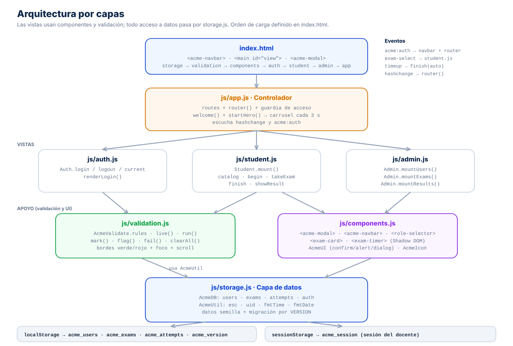

**Eventos personalizados que conectan los módulos**

| Evento | Lo emite | Lo escucha | Para qué |
|--------|----------|-----------|----------|
| `acme:auth` | `auth.js`, botón «Cerrar sesión» de `<acme-navbar>` | `<acme-navbar>`, `app.js` | Refrescar la navegación y revalidar el acceso. |
| `exam-select` | `<exam-card>` | `student.js › catalog()` | Abrir el modal de identificación del examen elegido. |
| `timeup` | `<exam-timer>` | `student.js › takeExam()` | Enviar el examen automáticamente al llegar a `00:00`. |
| `hashchange` | El navegador | `app.js › router()` | Cambiar de vista. |

---

## 5. Ramas y flujo de trabajo en Git

El desarrollo siguió un flujo **feature branch → Pull Request → `main`**: cada módulo se construyó en su propia rama, se subió a GitHub y se integró a `main` mediante un Pull Request. En total hay **13 Pull Requests** en tres fases: módulos JS (#1 a #7), interfaz (#8 y #9) y correcciones y documentación (#10 a #13). Así, cada parte del sistema tiene su historial aislado y es fácil de revisar o revertir.

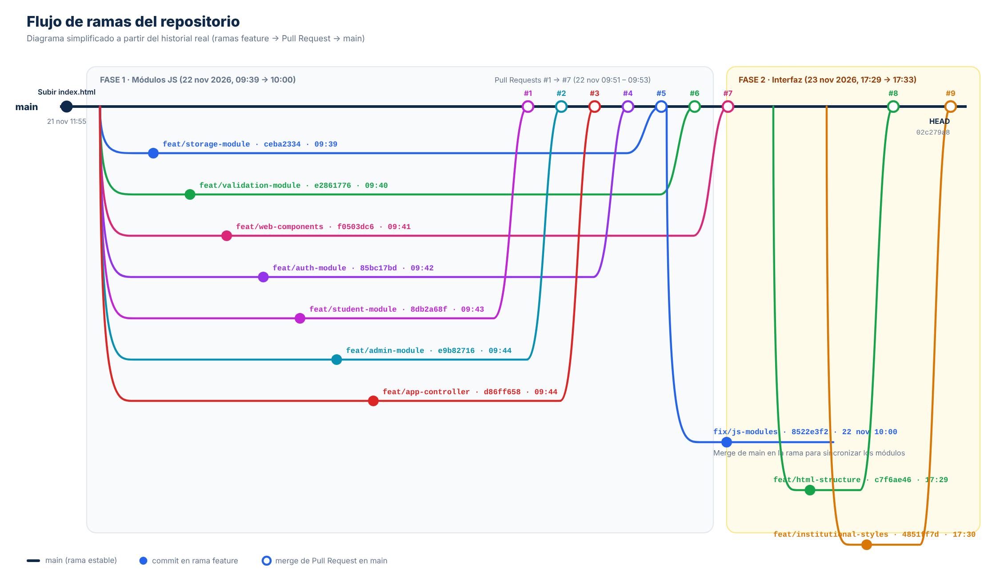

<details>
<summary><b>Ver el historial real del cliente Git (hasta el PR #13)</b></summary>

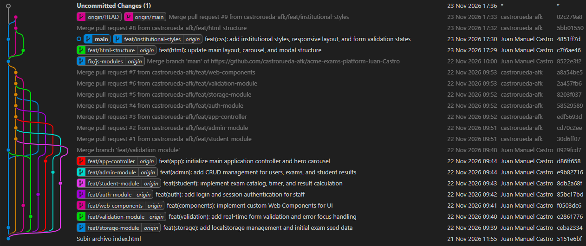

</details>

### 5.1 Convenciones

| Convención | Uso | Ejemplo |
|-----------|-----|---------|
| `main` | Rama estable; solo recibe merges de Pull Requests. | `main` |
| `feat/<módulo>` | Rama para construir una funcionalidad o módulo nuevo. | `feat/storage-module` |
| `fix/<área>` | Rama para corregir o sincronizar algo existente. | `fix/js-modules` |
| Mensajes de commit | Formato *Conventional Commits*: `tipo(ámbito): descripción en imperativo`. | `feat(auth): add login and session authentication for staff` |

### 5.2 Resumen de ramas

| # | Rama | Commit | Fecha (2026) | Pull Request | Archivo principal |
|---|------|--------|--------------|--------------|-------------------|
| 0 | `main` (commit inicial) | `5151e6bf` | 21 nov 11:55 | — | `index.html` |
| 1 | `feat/storage-module` | `ceba2334` | 22 nov 09:39 | #5 | `js/storage.js` |
| 2 | `feat/validation-module` | `e2861776` | 22 nov 09:40 | #6 | `js/validation.js` |
| 3 | `feat/web-components` | `f0503dc6` | 22 nov 09:41 | #7 | `js/components.js` |
| 4 | `feat/auth-module` | `85bc17bd` | 22 nov 09:42 | #4 | `js/auth.js` |
| 5 | `feat/student-module` | `8db2a68f` | 22 nov 09:43 | #1 | `js/student.js` |
| 6 | `feat/admin-module` | `e9b82716` | 22 nov 09:44 | #2 | `js/admin.js` |
| 7 | `feat/app-controller` | `d86ff658` | 22 nov 09:44 | #3 | `js/app.js` |
| 8 | `fix/js-modules` | `8522e3f2` | 22 nov 10:00 | — | Sincronización de los módulos JS |
| 9 | `feat/html-structure` | `c7f6ae46` | 23 nov 17:29 | #8 | `index.html` |
| 10 | `feat/institutional-styles` | `4851ff7d` | 23 nov 17:30 | #9 | `css/styles.css` |
| 11 | `fix/js-updates` | — | — | #10 | `js/app.js`, `js/storage.js` |
| 12 | `fix/html-structure` | — | — | #11 | `index.html` |
| 13 | `docs/project-readme` | — | — | #12 | `README.md` |
| 14 | `docs/technical-docs` | — | — | #13 | Documentación técnica y guías |

Las filas 11 a 14 corresponden a la fase de correcciones y documentación; el estado más reciente de `origin/main` es el *merge* del Pull Request #13. Los *merge commits* de los PR #1 a #9 son: #1 `30d6ff07`, #2 `cd70c2ee`, #3 `edf5693d`, #4 `58529589`, #5 `8203f037`, #6 `2a457fb6`, #7 `a8a54be5`, #8 `5bb01550` y #9 `02c279a8`.

### 5.3 Para qué se usó cada rama

#### `main`
Rama estable y publicada. Arrancó con un único commit (`Subir archivo index.html`) y desde ahí solo recibe Pull Requests ya revisados. Siempre contiene una versión que funciona.

#### `feat/storage-module` → `js/storage.js` (PR #5)
**Propósito:** construir primero la base de datos, porque todos los demás módulos dependen de ella.
- Define las claves de `localStorage` (`acme_users`, `acme_exams`, `acme_attempts`, `acme_version`) y la de sesión (`acme_session`).
- Carga los **datos semilla**: 2 usuarios y 5 exámenes (5 preguntas × 4 opciones, una sola correcta).
- Implementa las operaciones de `AcmeDB.users`, `AcmeDB.exams`, `AcmeDB.attempts` y `AcmeDB.auth`, con las reglas de negocio (identificación y correo únicos, código de examen único, mínimo 2 respuestas y exactamente 1 correcta).
- Incluye utilidades compartidas (`AcmeUtil`): escape de HTML, generación de ids y formato de tiempo y fecha.

#### `feat/validation-module` → `js/validation.js` (PR #6)
**Propósito:** centralizar la validación de formularios para no repetir código en cada vista.
- Biblioteca de reglas reutilizables (`required`, `minLength`, `digits`, `email`, `phone`, `password`, `integer`, `number`, `selected`).
- Pinta el borde **verde** (`#16a34a`) o **rojo** (`#dc2626`), crea el mensaje debajo del campo y ajusta `aria-invalid` / `aria-describedby`.
- Al enviar con errores: bloquea el envío, marca los campos inválidos y **lleva el foco y el scroll al primer error** (`.focus()` + `scrollIntoView({ behavior: 'smooth', block: 'center' })`).

#### `feat/web-components` → `js/components.js` (PR #7)
**Propósito:** modularizar la interfaz con elementos HTML personalizados.
- `<acme-modal>`, `<acme-navbar>`, `<role-selector>`, `<exam-card>` y `<exam-timer>` (este último con Shadow DOM).
- Los iconos SVG por materia y para los perfiles (`AcmeIcon`) y los diálogos reutilizables (`AcmeUI.confirm`, `AcmeUI.alert`, `AcmeUI.dialog`).

#### `feat/auth-module` → `js/auth.js` (PR #4)
**Propósito:** controlar el acceso del personal docente y administrativo.
- Inicio y cierre de sesión y consulta del usuario actual (`Auth.login`, `Auth.logout`, `Auth.current`).
- Vista de login con validación en vivo y un aviso discreto con las cuentas de prueba.

#### `feat/student-module` → `js/student.js` (PR #1)
**Propósito:** implementar el flujo público completo del estudiante.
- Catálogo de exámenes, modal de identificación con 4 campos obligatorios, vista del examen con temporizador, calificación y pantalla de resultados.
- Guarda cada intento (incluido el **tiempo exacto**, el curso y el correo) en `acme_attempts`.

#### `feat/admin-module` → `js/admin.js` (PR #2)
**Propósito:** implementar los tres módulos privados.
- CRUD de usuarios, CRUD de exámenes con gestor de preguntas y panel de resultados con filtros.

#### `feat/app-controller` → `js/app.js` (PR #3)
**Propósito:** unir todas las piezas.
- Router por hash, guardia de rutas privadas y pantalla de bienvenida con el **carrusel del hero** (cambio automático cada 3 segundos y puntos indicadores).

#### `fix/js-modules` (commit `8522e3f2`)
**Propósito:** rama de corrección de los módulos JS. Su último commit es un *merge* de `main` dentro de la rama, es decir, una **sincronización** con los Pull Requests #1 a #7 ya integrados, para dejar los módulos consistentes antes de empezar la fase visual.

#### `feat/html-structure` → `index.html` (PR #8)
**Propósito:** actualizar la estructura base del documento.
- Layout principal (`<acme-navbar>`, `<main id="view">`, pie de página) y el punto de montaje de `<acme-modal>`.
- Carga ordenada de los scripts (incluido `validation.js`). El markup del carrusel y de los perfiles lo genera `app.js` dentro de `<main>`.

#### `feat/institutional-styles` → `css/styles.css` (PR #9)
**Propósito:** dar identidad visual institucional a toda la plataforma.
- Paleta con variables CSS (`:root`), hero, carrusel, tarjetas, tablas y modal.
- Estados de validación (`.is-valid`, `.is-invalid`, `.field-msg`), diseño responsive (breakpoint de 760 px) y accesibilidad (`:focus-visible`, `prefers-reduced-motion`).

#### `fix/js-updates` → `js/app.js`, `js/storage.js` (PR #10)
**Mensaje del commit:** `fix(js): update app controller and localStorage data handling`
**Propósito:** corregir el controlador y el manejo de datos en `localStorage` después de probar la plataforma.
- **Carrusel del hero** en `app.js`: cambio automático cada 3 segundos, puntos indicadores y limpieza del intervalo al cambiar de ruta.
- **Sesión persistente** en `storage.js`: el id del docente ahora se guarda en `localStorage`, así que no se cierra al recargar ni al reiniciar el navegador. Un listener del evento `storage` en `app.js` sincroniza las pestañas abiertas.
- **Corrección de datos:** `init()` comparaba mal la clave `acme_version` y reiniciaba los datos y la sesión en cada carga; ahora usa `read(KEYS.version, null)`.

#### `fix/html-structure` → `index.html` (PR #11)
**Mensaje del commit:** `fix(html): update main structure, carousel, and form elements`
**Propósito:** ajustar la estructura del documento, el carrusel y los elementos de formulario.
- Carga de `js/validation.js` en el orden correcto (después de `storage.js`).
- Estructura del hero con carrusel y de los formularios (los 4 campos obligatorios del estudiante y los mensajes de validación bajo cada campo).

#### `docs/project-readme` → `README.md` (PR #12)
**Mensaje del commit:** `docs(readme): add project overview, features, and setup instructions`
**Propósito:** documentar el proyecto para que cualquier persona pueda entenderlo y ejecutarlo.
- Descripción general, funcionalidades, credenciales de prueba, estructura de carpetas e instrucciones de ejecución.

#### `docs/technical-docs` → documentación técnica (PR #13)
**Mensaje del commit:** `docs: add technical documentation and project guides`
**Propósito:** documentar el detalle técnico: mockups de estructura, diagramas de arquitectura y de ramas, tablas de requerimientos, explicación del código por archivo y guías del proyecto (carpeta `docs/`).

### 5.4 Comandos del flujo de trabajo

```bash
git checkout main
git pull origin main
git checkout -b feat/nombre-del-modulo

git add .
git commit -m "feat(ambito): descripcion en imperativo"
git push -u origin feat/nombre-del-modulo
```

Después se abre el **Pull Request** en GitHub (`feat/nombre-del-modulo` → `main`), se revisa y se hace el *merge*. Para mantener una rama al día con `main`:

```bash
git checkout feat/nombre-del-modulo
git merge main
```

### 5.5 Registro de cambios posteriores a la fase visual

Resumen de lo que cambió después de la primera versión de la interfaz (PR #8 y #9).

| # | Cambio | Qué se hizo | Archivos | PR |
|---|--------|-------------|----------|----|
| 1 | **Carrusel automático del hero** | Fondo con 4 fotos que cambian con *fade* cada 3 s, capa azul marino (`rgba(15,41,74,.85)` → `.78`), `text-shadow` en los textos y puntos indicadores clicables. Las imágenes que no cargan se omiten. | `js/app.js`, `css/styles.css` | #10, #11 |
| 2 | **Registro del estudiante con 4 campos obligatorios** | Identificación (solo números, mínimo 5 dígitos), nombre (mínimo 3 caracteres), curso o grado y correo con formato válido. | `js/student.js` | #10, #11 |
| 3 | **Curso y correo en los resultados** | El intento guarda `course` y `email`; la tabla del docente muestra las columnas **Curso** y **Correo** y permite buscar por ellos. | `js/student.js`, `js/admin.js` | #10, #11 |
| 4 | **Validación en tiempo real en todos los formularios** | Módulo nuevo `validation.js`: borde verde (`#16a34a`) si es válido y rojo (`#dc2626`) con mensaje si no; al enviar con errores se bloquea el envío y se lleva el foco y el scroll al primer campo incorrecto. Se usa en login, modal del estudiante, usuarios, exámenes y preguntas. | `js/validation.js`, `js/auth.js`, `js/student.js`, `js/admin.js`, `css/styles.css`, `index.html` | #10, #11 |
| 5 | **Sesión persistente del docente** | La sesión pasó de `sessionStorage` a `localStorage`: no se cierra al recargar la página ni al reiniciar el navegador; termina al pulsar «Cerrar sesión». Las pestañas abiertas se sincronizan con el evento `storage`. | `js/storage.js`, `js/app.js` | #10 |
| 6 | **Corrección del reinicio de datos** | `init()` comparaba mal `acme_version` (la clave se guarda como JSON) y reiniciaba usuarios, exámenes, intentos y sesión en cada carga. Ahora los datos se conservan entre recargas y solo se reinician si cambia `VERSION`. | `js/storage.js` | #10 |
| 7 | **Documentación** | README con mockups de estructura, diagramas de arquitectura y de ramas, tablas de requerimientos, explicación del código y guía de estudio. | `README.md`, `docs/` | #12, #13 |

> **Nota sobre la asignación a cada PR:** la columna «PR» se dedujo de los mensajes de commit. Para ver los archivos exactos de cada uno, abre el Pull Request en GitHub y revisa la pestaña **Files changed**.

**Impacto de los cambios 5 y 6 en el uso**

| Antes | Ahora |
|-------|-------|
| Al recargar la página se perdían los intentos de los estudiantes, los usuarios y exámenes creados y la sesión. | Todo se conserva tras recargar o reiniciar el navegador. |
| El docente debía iniciar sesión de nuevo al abrir otra pestaña o al reiniciar el navegador. | La sesión se mantiene hasta pulsar «Cerrar sesión». |

---

## 6. Requerimientos → dónde se implementan

### 6.1 Arquitectura y datos

| Requerimiento | Dónde está | Cómo se cumple |
|---------------|-----------|----------------|
| HTML5, CSS3 y JavaScript vanilla, sin frameworks | Todo el repositorio | No hay dependencias. Lo único externo son las fotos de Unsplash del hero y de las portadas, que tienen respaldo de color si no cargan. |
| Web Components nativos | `js/components.js` | Cinco elementos registrados con `customElements.define`: `acme-modal`, `acme-navbar`, `role-selector`, `exam-card`, `exam-timer`. |
| Shadow DOM | `js/components.js › ExamTimer` | El constructor llama a `attachShadow({ mode: 'open' })` y encapsula sus propios estilos. |
| Base de datos JSON en `localStorage` | `js/storage.js` | Funciones `read` / `write` con `JSON.parse` / `JSON.stringify` sobre las claves `acme_*`. |
| Datos semilla (≥ 5 exámenes completos) | `js/storage.js › buildSeed()` + `init()` | Se cargan 2 usuarios y 5 exámenes la primera vez; `VERSION` fuerza una recarga si cambia el esquema. |
| Control de acceso (público / privado) | `js/app.js › routes` + `router()` | Cada ruta tiene `private: true/false`; sin sesión se redirige a `#/login`. |
| Sesión activa | `js/storage.js › auth` | Guarda el id del usuario en `localStorage` (`acme_session`), por lo que la sesión se mantiene al recargar o reiniciar el navegador hasta pulsar «Cerrar sesión». |
| Cierre de sesión | `js/components.js › AcmeNavbar` | El botón `[data-logout]` llama a `AcmeDB.auth.logout()` y emite `acme:auth`. |
| Persistencia al reiniciar el navegador | `js/storage.js` | Usuarios, exámenes e intentos viven en `localStorage`, que no se borra al cerrar el navegador. |

### 6.2 Perfil de entrada y módulo del estudiante

| Requerimiento | Dónde está | Cómo se cumple |
|---------------|-----------|----------------|
| Pantalla de selección de perfil | `js/app.js › welcome()` + `components.js › RoleSelector` | Dos tarjetas grandes: «Soy Estudiante» (`#/estudiante`) y «Soy Docente / Administrativo» (`#/login`). |
| Catálogo en tarjetas | `js/student.js › catalog()` + `components.js › ExamCard` | Cada tarjeta muestra portada con icono SVG, título, descripción, tiempo, % de aprobación y número de preguntas. |
| Identificación obligatoria antes de iniciar | `js/student.js › begin()` | Abre `AcmeUI.dialog` con 4 campos; el examen no inicia hasta que `AcmeValidate.run()` devuelve `true`. |
| Encabezado fijo con título, preguntas, % y datos del estudiante | `js/student.js › takeExam()` + `css/styles.css › .exam-head` | `position: sticky; top: 0`. |
| Reloj `MM:SS` que cambia de color en el último minuto | `js/components.js › ExamTimer._tick()` | Clase `warn` cuando quedan menos de 60 s (fondo rojo y pulso). |
| Envío automático al llegar a `00:00` | `ExamTimer` + `student.js › takeExam()` | El temporizador emite `timeup` y se llama a `finish(form, timer, true)`. |
| Opciones tipo tarjeta seleccionables | `student.js › takeExam()` + `css › .option` | `<input type="radio" name="q_<id>">` dentro de un `<label class="option">`; se resalta con `:has(input:checked)`. |
| «Terminar Examen» con confirmación | `student.js › finish()` | `AcmeUI.confirm(...)`, que avisa cuántas preguntas quedaron sin responder. |
| Calificación y APROBÓ / NO APROBÓ | `student.js › finish()` y `showResult()` | `percent = aciertos / total`; `passed = percent >= passPercent`. |
| Guardar el intento completo | `student.js › finish()` → `AcmeDB.attempts.add()` | Guarda id, nombre, curso, correo, examen, fecha, puntaje, estado y segundos. |
| Tiempo exacto empleado | `student.js › takeExam()` / `finish()` | `startedAt = Date.now()` y `seconds` calculados en el cierre (o el límite completo si fue automático); se muestra con `AcmeUtil.fmtTime`. |

### 6.3 Módulos privados

| Requerimiento | Dónde está | Cómo se cumple |
|---------------|-----------|----------------|
| Login con correo y contraseña | `js/auth.js › renderLogin()` + `storage.js › auth.login()` | Compara contra los usuarios guardados y muestra errores visuales. |
| Usuario precargado visible para pruebas | `js/auth.js › renderLogin()` | Aviso discreto `.demo-note` con las cuentas semilla. |
| CRUD de usuarios (6 campos) | `js/admin.js › mountUsers()` | Formulario + tabla; `save`, `edit`, `remove` y `renderTable`. |
| Identificación y correo únicos | `js/storage.js › users.save()` | Lanza un error que la vista marca sobre el campo correspondiente. |
| CRUD de exámenes (5 campos) | `js/admin.js › mountExams()` | `saveExam`, `editExam`, `removeExam`; código único en `exams.save()`. |
| Gestor de preguntas integrado | `js/admin.js › mountExams()` | `renderQuestions`, `addAnswerRow`, `saveQuestion`, `removeQuestion`. |
| **Una sola** respuesta correcta | `admin.js › addAnswerRow()` + `storage.js › saveQuestion()` | Los radios comparten `name="correct"` (solo uno marcado) y el almacenamiento rechaza cualquier pregunta que no tenga exactamente una correcta. |
| Mínimo 2 respuestas | `admin.js` (botón ✕) + `storage.js › saveQuestion()` | Se impide quitar la segunda respuesta y se valida al guardar. |
| Panel de resultados con filtros | `js/admin.js › mountResults()` | Filtro por examen y búsqueda por nombre, identificación, curso o correo; contadores y tabla de 9 columnas. |

### 6.4 Diseño, UX y accesibilidad

| Requerimiento | Dónde está | Cómo se cumple |
|---------------|-----------|----------------|
| Paleta institucional (`#0f294a`, `#1d4ed8`, `#d97706`) | `css/styles.css › :root` | Variables `--navy`, `--blue`, `--amber` y derivadas. |
| Hero con carrusel automático cada 3 s | `js/app.js › welcome()`, `startHero()` + `css › .hero-carousel` | 4 diapositivas con *fade* (`opacity` + `transform`), intervalo `HERO_INTERVAL = 3000`. |
| Legibilidad del texto sobre las fotos | `css › .hero-carousel::before`, `text-shadow` | Gradiente `rgba(15,41,74,.85) → rgba(15,41,74,.78)` y sombra de texto. |
| Puntos indicadores | `app.js › startHero()` + `css › .hero-dot` | El punto activo se alarga y se pinta en ámbar; son botones clicables. |
| Insignias / iconos SVG por materia | `js/components.js › SVG`, `AcmeIcon()` | Iconos por materia y para los perfiles (estudiante y docente). |
| Imágenes de portada por materia | `js/storage.js › SUBJECTS` + `ExamCard` | Portada con degradado de color + foto con `onerror` que la retira si falla. |
| Responsive | `css › @media (max-width: 760px)` | Menú hamburguesa, tarjetas en una columna, tablas con scroll horizontal. |
| Accesibilidad | `components.js`, `validation.js`, `css` | `role="dialog"`, `aria-modal`, `aria-invalid`, `aria-describedby`, `aria-live`, `:focus-visible`, `prefers-reduced-motion` y `lang="es"`. |

### 6.5 Validación de formularios

| Requerimiento | Dónde está | Cómo se cumple |
|---------------|-----------|----------------|
| Campos obligatorios del estudiante (identificación ≥ 5 dígitos, nombre ≥ 3, curso, correo) | `js/student.js › begin()` | Reglas `R.digits`, `R.minLength` y `R.email` con atributo `required`. |
| Curso y correo guardados en el resultado | `student.js › finish()` | Campos `course` y `email` en el objeto del intento; visibles en `admin.js › mountResults()`. |
| Validación mientras se escribe | `validation.js › live()` | Escucha `input` / `change` y `blur`. |
| Borde verde / rojo con mensaje | `validation.js › mark()` + `css › .is-valid / .is-invalid / .field-msg` | Crea (una sola vez) un `<small class="field-msg">` bajo el campo. |
| Foco y scroll al primer error | `validation.js › run()` y `goTo()` | `el.focus({ preventScroll: true })` + `scrollIntoView({ behavior: 'smooth', block: 'center' })`. |
| Aplicado en todos los formularios | `auth.js`, `student.js`, `admin.js` | Login, modal del estudiante, usuarios, exámenes y preguntas usan el mismo motor. |

---

## 7. Explicación detallada del código

### 7.1 `js/storage.js` — capa de datos

Es un módulo autoejecutable (IIFE) que publica dos objetos globales.

**`AcmeDB`**

| Grupo | Métodos | Detalle |
|-------|---------|---------|
| `users` | `list()`, `save(data)`, `remove(id)` | `save` crea o actualiza según exista `data.id` y valida que la identificación y el correo no se repitan. |
| `exams` | `list()`, `get(id)`, `save(data)`, `remove(id)` | `save` valida el código único y conserva las preguntas al editar. |
| `exams` (preguntas) | `saveQuestion(examId, q)`, `removeQuestion(examId, qId)` | Exige enunciado, ≥ 2 respuestas con texto y exactamente 1 correcta. |
| `attempts` | `list()`, `add(attempt)` | Historial de intentos de los estudiantes. |
| `auth` | `login(email, password)`, `logout()`, `current()` | La sesión se guarda en `localStorage` (clave `acme_session`) y se borra con `logout()`. |
| `subjects` | objeto `SUBJECTS` | Etiqueta, colores y foto de portada de cada materia. |

**`AcmeUtil`:** `esc` (escapa HTML para evitar inyección al usar `innerHTML`), `uid`, `fmtTime` (segundos → `MM:SS`) y `fmtDate`.

**Datos semilla y migración.** `init()` compara la clave `acme_version` con la constante `VERSION`. Si no coincide (primer uso o esquema antiguo) reescribe usuarios, exámenes e intentos con los datos semilla; si coincide, solo completa las claves que falten, sin pisar lo que ya guardó el usuario.

### 7.2 `js/validation.js` — validación en tiempo real

Cada campo se describe con un objeto `{ el, rule }`, donde `rule` es una función que recibe el valor y devuelve `''` (válido) o el mensaje de error.

```js
const R = AcmeValidate.rules;
const items = [
  { el: f.email, rule: R.email('El email') },
  { el: f.password, rule: R.password('La contraseña', 4) }
];
AcmeValidate.live(items);
if (!AcmeValidate.run(items)) return;
```

| Función | Qué hace |
|---------|----------|
| `rules.*` | Fábricas de reglas: `required`, `minLength`, `digits`, `email`, `phone`, `password`, `integer`, `number`, `selected`. |
| `mark(el, msg)` | Aplica `is-valid` / `is-invalid`, actualiza el mensaje y los atributos ARIA. |
| `flag(el)` | Marca un campo en rojo sin texto (para errores de credenciales). |
| `live(items)` | Valida al escribir (`input` / `change`) y al salir del campo (`blur`). |
| `run(items)` | Valida todo de una vez; si hay errores, enfoca el primero y devuelve `false`. |
| `fail(el, msg)` | Marca un error de negocio (p. ej. «correo ya registrado») y enfoca el campo. |
| `clear` / `clearAll(scope)` | Quitan los estados visuales (al cancelar o resetear un formulario). |

### 7.3 `js/components.js` — Web Components

| Elemento | DOM | Descripción |
|----------|-----|-------------|
| `<acme-modal>` | Light | `open({...})` devuelve una `Promise<boolean>`. Acepta `html` propio y una función `validate(body)`: si devuelve un texto, el modal no se cierra y lo muestra. Se cierra con `Esc` y confirma con `Enter`. |
| `<acme-navbar>` | Light | Muestra enlaces públicos o privados según `AcmeDB.auth.current()` y se vuelve a pintar con `acme:auth` y `hashchange`. Incluye el botón hamburguesa. |
| `<role-selector>` | Light | Las dos tarjetas de perfil. |
| `<exam-card>` | Light | Propiedad `exam` (se asigna desde JS) y evento `exam-select` con `detail.id`. |
| `<exam-timer>` | **Shadow** | `start(segundos)`, `stop()`, `remaining`, `elapsed` y el evento `timeup`. Calcula el tiempo con `Date.now()`, por lo que no se desfasa aunque la pestaña quede en segundo plano. |

`AcmeUI` ofrece tres atajos sobre el modal: `confirm(...)`, `alert(...)` y `dialog(options)`.

### 7.4 `js/auth.js` — acceso del personal

`renderLogin(el)` pinta el formulario, registra las reglas (`R.email`, `R.password`) y, al enviar, llama a `Auth.login`. Si falla, marca ambos campos en rojo, muestra el mensaje y enfoca el correo. Si es correcto, emite `acme:auth` y navega a `#/usuarios`.

### 7.5 `js/student.js` — flujo del estudiante

`mount(el)` mantiene un estado `{ view, exam, student, result }` y alterna entre tres vistas:

1. **`catalog()`** crea un `<exam-card>` por examen y escucha `exam-select`.
2. **`begin(id)`** abre el modal de identificación. Registra las reglas de los 4 campos *después* de abrir el diálogo, y `validate` solo deja continuar cuando `AcmeValidate.run(items)` es verdadero.
3. **`takeExam()`** pinta el encabezado fijo y las preguntas, y arranca el temporizador:

```js
timer.addEventListener('timeup', () => finish(form, timer, true));
form.addEventListener('submit', (e) => { e.preventDefault(); finish(form, timer, false); });
startedAt = Date.now();
timer.start(exam.minutes * 60);
```

4. **`finish(form, timer, auto)`** recoge las respuestas, pide confirmación (si no es automático), calcula el resultado y lo guarda:

| Campo guardado | Origen |
|----------------|--------|
| `correct`, `total`, `percent` | Conteo de respuestas correctas sobre el total. |
| `passed` | `percent >= passPercent` del examen. |
| `seconds` | Tiempo real transcurrido (o el límite completo si se agotó el tiempo). |
| `course`, `email` | Datos del modal de identificación. |

5. **`showResult()`** muestra el porcentaje, el estado, los aciertos, el mínimo y el tiempo empleado.

### 7.6 `js/admin.js` — módulos privados

- **`mountUsers(el)`:** formulario de 6 campos y tabla. Los errores de unicidad de `storage.js` se asocian al campo correcto (`identificación` o `correo`). No permite eliminar al usuario con sesión activa.
- **`mountExams(el)`:** formulario de examen, tabla y un panel de preguntas que se abre con «Preguntas». Cada respuesta es una fila con un radio (`name="correct"`) y un texto; se valida que cada respuesta tenga contenido y que haya una correcta marcada.
- **`mountResults(el)`:** filtra los intentos por examen y por texto libre, calcula los contadores (presentados, aprobados, reprobados, promedio) y los ordena por fecha descendente. Muestra curso y correo (los intentos antiguos que solo tienen `contact` siguen viéndose).

### 7.7 `js/app.js` — controlador

```js
const routes = {
  '/':            { mount: (el) => { welcome(el); startHero(el); }, private: false },
  '/estudiante':  { mount: (el) => Student.mount(el), private: false },
  '/login':       { mount: (el) => Auth.renderLogin(el), private: false },
  '/usuarios':    { mount: (el) => Admin.mountUsers(el), private: true },
  '/examenes':    { mount: (el) => Admin.mountExams(el), private: true },
  '/resultados':  { mount: (el) => Admin.mountResults(el), private: true }
};
```

`router()` detiene el carrusel anterior, resuelve la ruta y aplica la guardia: una ruta privada sin sesión redirige a `#/login`, y `#/login` con sesión redirige a `#/usuarios`.

**Carrusel (`startHero`)**

| Detalle | Implementación |
|---------|----------------|
| Cambio automático | `setInterval(next, 3000)` |
| Transición | Clase `.active` con `opacity` y `transform` (CSS) |
| Puntos | Botones que llaman a `show(i)` y reinician el temporizador |
| Imagen rota | Se precarga cada URL; si falla, se omite y se oculta su punto |
| Limpieza | `stopHero()` en cada cambio de ruta y si el elemento ya no existe |

### 7.8 `css/styles.css` — secciones

| Sección | Selectores principales |
|---------|-----------------------|
| Variables y base | `:root`, `body`, `.container` |
| Navegación | `.navbar`, `.nav-links`, `.burger`, `.avatar` |
| Botones | `.btn`, `.btn-ghost`, `.btn-amber`, `.btn-danger` |
| Hero y carrusel | `.hero`, `.hero-carousel`, `.hero-slide`, `.hero-dots`, `.hero-dot` |
| Perfiles | `.roles`, `.role-card`, `.role-avatar` |
| Formularios y validación | `label`, `input`, `.is-valid`, `.is-invalid`, `.field-msg`, `.error` |
| Tablas y paneles | `.table-wrap`, `table`, `.status`, `.q-list`, `.answer-row` |
| Catálogo | `.cards`, `.exam-card`, `.cover`, `.chip` |
| Examen | `.exam-head` (sticky), `.question`, `.option` |
| Resultado | `.result`, `.score`, `.badge` |
| Modal | `.modal-backdrop`, `.modal` |
| Responsive y accesibilidad | `@media (max-width: 760px)`, `prefers-reduced-motion`, `:focus-visible` |

---

## 8. Modelo de datos

Claves en `localStorage`: `acme_users`, `acme_exams`, `acme_attempts`, `acme_version` y `acme_session` (id del docente con sesión activa).

```json
{
  "acme_users": [
    {
      "id": "uuid",
      "identification": "1000000001",
      "fullName": "Administrador Acme",
      "email": "admin@acme.edu.co",
      "phone": "3001234567",
      "role": "Administrativo",
      "password": "123456"
    }
  ],
  "acme_exams": [
    {
      "id": "uuid",
      "code": "MAT-101",
      "subject": "matematicas",
      "title": "Matemáticas",
      "minutes": 15,
      "passPercent": 70,
      "description": "Operaciones, porcentajes, álgebra básica y geometría.",
      "questions": [
        {
          "id": "uuid",
          "text": "¿Cuánto es 12 × 8?",
          "answers": [
            { "id": "uuid", "text": "86", "correct": false },
            { "id": "uuid", "text": "96", "correct": true }
          ]
        }
      ]
    }
  ],
  "acme_attempts": [
    {
      "id": "uuid",
      "examId": "uuid",
      "examCode": "MAT-101",
      "examTitle": "Matemáticas",
      "studentId": "10456789",
      "studentName": "Ana Pérez",
      "course": "10-A",
      "email": "ana@correo.com",
      "correct": 4,
      "total": 5,
      "percent": 80,
      "passPercent": 70,
      "passed": true,
      "seconds": 462,
      "auto": false,
      "answers": { "questionId": "answerId" },
      "date": "2026-11-22T15:30:00.000Z"
    }
  ]
}
```

---

## 9. Reglas de validación

| Formulario | Campo | Regla | Ejemplo de mensaje |
|-----------|-------|-------|--------------------|
| Estudiante | Identificación | Solo dígitos, 5 a 15 | «El número de identificación debe tener mínimo 5 dígitos.» |
| Estudiante | Nombre completo | Mínimo 3 caracteres | «El nombre completo debe tener al menos 3 caracteres.» |
| Estudiante | Curso / Grado | Obligatorio, mínimo 2 caracteres | «El curso o grado es obligatorio.» |
| Estudiante | Correo | Formato `usuario@dominio.com` | «Escribe un correo válido, por ejemplo usuario@dominio.com.» |
| Login | Correo y contraseña | Correo válido; contraseña ≥ 4 | «Correo o contraseña incorrectos.» |
| Usuarios | Identificación | Dígitos, 5 a 15 y única | «Ya existe un usuario con ese número de identificación.» |
| Usuarios | Nombre / Email / Teléfono | ≥ 3 caracteres / formato válido / 7 a 15 caracteres (`0-9 + - espacio`) | — |
| Usuarios | Cargo / Contraseña | Cargo seleccionado / contraseña ≥ 4 | «Selecciona un cargo.» |
| Exámenes | Código / Título | ≥ 2 / ≥ 3 caracteres; código único | «Ya existe un examen con ese código.» |
| Exámenes | Tiempo | Entero entre 1 y 600 | «El tiempo debe estar entre 1 y 600.» |
| Exámenes | % de aprobación | Número entre 0 y 100 | «El porcentaje de aprobación debe estar entre 0 y 100.» |
| Exámenes | Descripción | ≥ 5 caracteres | — |
| Preguntas | Enunciado y respuestas | Enunciado ≥ 3; todas las respuestas con texto | «La descripción de la respuesta es obligatoria.» |
| Preguntas | Respuesta correcta | Exactamente una marcada; mínimo 2 respuestas | «Marca cuál es la respuesta correcta.» |

---

## 10. Cómo ejecutarlo y probarlo

1. Clona el repositorio:
   ```bash
   git clone https://github.com/castrorueda-afk/acme-exams-platform-Juan-Castro.git
   ```
2. Abre la carpeta en **VS Code** y ejecuta **Live Server** (o abre `index.html` directamente).
3. Usa siempre la **misma dirección** (por ejemplo `http://127.0.0.1:5500`): `localStorage` guarda los datos por origen.

**Lista de pruebas manuales**

- [ ] La pantalla de bienvenida muestra el carrusel cambiando cada 3 segundos y los puntos indicadores.
- [ ] «Soy Estudiante» abre el catálogo con 5 exámenes y sus portadas.
- [ ] Al elegir un examen, el modal bloquea el avance si hay campos vacíos o con formato incorrecto, y enfoca el primer error.
- [ ] El temporizador baja en tiempo real, se pone rojo con menos de 1 minuto y envía el examen en `00:00`.
- [ ] «Terminar Examen» pide confirmación y muestra APROBÓ / NO APROBÓ con el tiempo empleado.
- [ ] Iniciar sesión con `admin@acme.edu.co` / `123456` y ver el intento en **Resultados** (con curso y correo).
- [ ] Cerrar el navegador y volver a abrirlo en la misma dirección: los datos siguen ahí y la sesión del docente sigue iniciada hasta que pulses «Cerrar sesión».
- [ ] Crear, editar y eliminar un usuario, un examen y una pregunta; verificar que no deja guardar una pregunta sin respuesta correcta.
- [ ] Reducir la ventana a 375 px: el menú hamburguesa y las tablas con scroll funcionan.

Para reiniciar los datos: DevTools → *Application* → *Local Storage* → *Clear*.

---

## 11. Limitaciones y mejoras futuras

- Proyecto académico: las contraseñas se guardan en texto plano y la autenticación ocurre en el cliente. En producción se necesitaría un backend con contraseñas con *hash* y control de acceso real.
- `localStorage` es local a cada navegador y dispositivo: los resultados de un estudiante no aparecen en otro equipo.
- Mejoras posibles: exportar resultados a CSV, intentos por estudiante con límite, aleatorizar preguntas y opciones, temporizador persistente ante recargas y base de datos en la nube.

---

## 12. Autoría

| Rol | Persona |
|-----|---------|
| Desarrollo | **Juan Manuel Castro** · GitHub [`@castrorueda-afk`](https://github.com/castrorueda-afk) |

<div align="center">

*Acme School · Plataforma de exámenes en línea · 2026*

</div>
